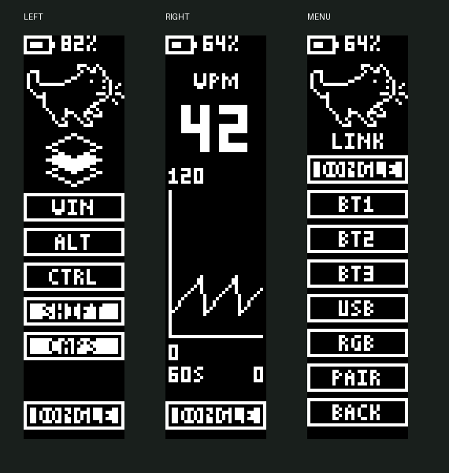

# PandaKB Sofle RMK

Experimental RMK firmware for the PandaKB Sofle with nice!nano v2–compatible nRF52840 controllers. The keyboard works over USB, Bluetooth or an optional USB receiver built with a 3rd controller.

## OLED displays



*Firmware-rendered preview of the left display, right display and connection menu.*

## Features

| Feature | Details |
| --- | --- |
| Hardware | 2 EC11 encoders, 2 SSD1306 displays (128 × 32), 36 RGB LEDs per half |
| Connectivity | BLE between halves, direct USB, 3 Bluetooth host profiles and an optional receiver |
| Vial | 8 layers, encoder mapping, Tap Dance, combos and 8 configurable Key Overrides |
| OLED | Battery status on both halves, layer and modifiers on the left, WPM and a 60 s graph on the right |
| RGB | Per-key and per-layer colors over WebHID, persistent settings, 10 brightness levels and 10 saturation levels for keyboard controls |
| Navigation | NAV on layer 6 and MOUSE on layer 7 |

## Build and flash

Install Rust with the `thumbv7em-none-eabihf` target, a host C compiler, Clang with libclang, `arm-none-eabi-objcopy` and Python 3.11+. RC8 was built with Rust 1.99.1.

```sh
rustup target add thumbv7em-none-eabihf
python tools/build_firmware.py
```

The script checks the application addresses and writes 3 UF2 files to `build/uf2/`.

| Board | Firmware |
| --- | --- |
| Left half | `PandaKB_Sofle_LEFT_UI_RC8.uf2` |
| Right half | `PandaKB_Sofle_RIGHT_UI_RC8.uf2` |
| USB receiver | `PandaKB_Sofle_RECEIVER_UI_RC8.uf2` |

1. Back up your layout in Vial using **File → Save current layout**.
2. Connect each board individually and double-press Reset to open the `NICENANO` drive.
3. Copy the matching UF2 to the drive and reopen Vial after the keyboard restarts.

From RC7, update LEFT to get Key Overrides. From RC4–RC6, update both halves. From RC3 or earlier, update all 3 boards.

## Tools and verification

Install `hidapi` with `python -m pip install hidapi` for the USB tools.

- `python tools/NRF-DFU/enter_dfu.py --list` lists boards. Use `--role left`, `--role right` or `--role receiver` to enter the bootloader over USB.
- `python tools/NAV-MOUSE/install_nav_mouse.py` checks the existing keymap before installing the preset. Add `--apply` to write the bindings.
- `cargo run --locked --manifest-path firmware/tests/Cargo.toml` runs the firmware logic tests on the host.

See [RC8 verification](release/verification.json) and [third-party notices](THIRD_PARTY_NOTICES.md).
